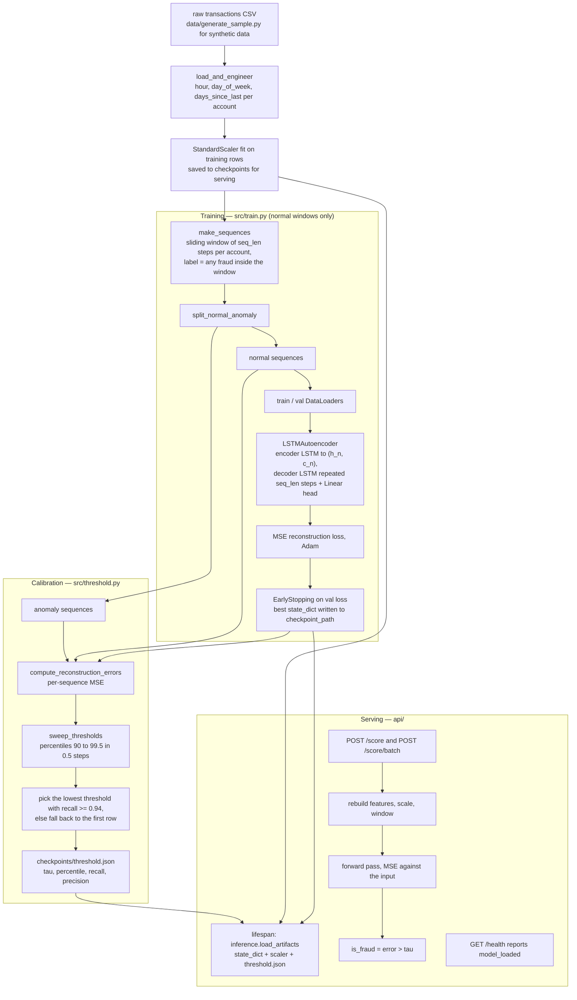

# Fraud Sentinel

LSTM Autoencoder for financial transaction anomaly detection. Trains on normal transaction sequences, detects anomalies via reconstruction error threshold with ≥94% recall. Deployed as a FastAPI microservice.

## Architecture



## Overview

- **LSTM Autoencoder**: Encoder (2-layer LSTM) → Decoder (2-layer LSTM) → reconstruction MSE
- **Threshold calibration**: Sweep percentiles 90–99.9%, select lowest threshold achieving ≥94% recall
- **FastAPI service**: `/score` (single) and `/score/batch` endpoints with <50ms latency
- **Distribution shift analysis**: Compare train/test reconstruction error distributions

## Tech Stack

Python 3.11 · PyTorch · FastAPI · Pandas · scikit-learn · joblib

## Quickstart

```bash
pip install -r requirements.txt

# Generate synthetic data
python data/generate_sample.py

# Train autoencoder (on normal transactions only)
python -m src.train

# Calibrate anomaly threshold
python -m src.threshold

# Start API
MODEL_CHECKPOINT=checkpoints/best_model.pt \
SCALER_PATH=checkpoints/scaler.joblib \
THRESHOLD_PATH=checkpoints/threshold.json \
uvicorn api.main:app --port 8001

# Score a sequence
curl -X POST http://localhost:8001/score \
  -H "Content-Type: application/json" \
  -d '{"transactions": [...]}'

# Tests
pytest tests/ -v
```

## Evaluation

Anomaly-detection metrics are computed in `src/threshold.py` against a labelled holdout (mix of normal + fraudulent sequences synthesised by `data/generate_sample.py`).

| Metric | What it measures | How to compute |
|--------|------------------|----------------|
| Recall @ chosen threshold | Fraction of true frauds caught | `python -m src.threshold` sweeps percentile thresholds and selects the lowest one with recall >= 0.94 |
| Precision @ chosen threshold | Fraction of alerts that are real frauds | Reported alongside recall in `checkpoints/threshold.json` |
| F1 @ chosen threshold | Harmonic mean of precision/recall | Same artifact |
| False-positive rate (FPR) | Normal sequences flagged as fraud | Logged for each candidate threshold during the sweep |
| PR-AUC | Threshold-free quality of reconstruction-error scores | `sklearn.metrics.average_precision_score(y_true, recon_error)` over the holdout; printed by the calibration script |
| ROC-AUC | Secondary diagnostic | `sklearn.metrics.roc_auc_score` on the same scores |
| Alert precision @ k | Precision when alerting only on the top-k riskiest sequences per day | Sort scored sequences by reconstruction error, take top-k, compute fraction labelled fraud |

Run end-to-end:

```bash
python data/generate_sample.py        # synthetic train + labelled holdout
python -m src.train                   # train autoencoder on normal-only
python -m src.threshold               # writes checkpoints/threshold.json with metrics
```

Distribution-shift sanity check: compare reconstruction-error histograms on train vs. holdout-normal vs. holdout-fraud (same script). Healthy models show clear separation between the normal and fraud distributions.

## Model

- Encoder: `LSTM(6, 128, 2 layers)` → `(h_n, c_n)`
- Decoder: repeat `h_n[-1]` × T → `LSTM(128, 128, 2 layers)` → `Linear(128, 6)`
- Loss: MSE between input and reconstruction
- Threshold: 99th percentile of training set reconstruction errors (tuned for ≥94% recall)
